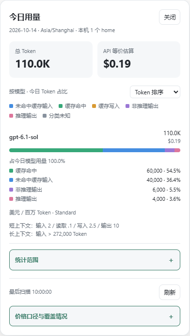
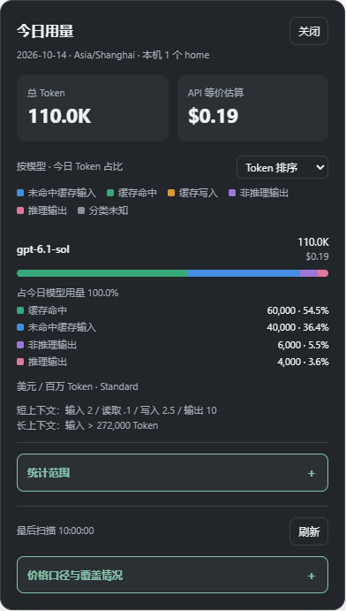

# codex-usage-display

[下载完整发行包](https://github.com/gcyyy/codex-usage-display/releases) · [安装细节](docs/INSTALLATION.md) · [干净电脑验收](docs/CLEAN_MACHINE_TEST.md) · [CI](https://github.com/gcyyy/codex-usage-display/actions/workflows/ci.yml)

为 **Windows x64 的 Codex 桌面应用**增加当日 Token 与 API 等价金额面板。入口在右上角、最小化按钮左侧，可拖动；点击查看模型用量、缓存命中、推理占比及价格覆盖。

这是独立社区项目，依赖 **Codex++** 加载用户脚本，不是 OpenAI 官方功能。采集器只读取本机用量日志，不调用模型 API，不需要 API Key。

## 最新版本 0.2.5

0.2.5 新增面板“启动采集器”按钮，离线时可直接启动后台进程并恢复连接，需要配套 bridge v2。

0.2.4 新增自动兼容性检查：面板显示宿主文件变化、未验证日志版本及对应修复步骤，可复制无令牌/正文的诊断摘要。桥接断开时双击安装目录的 `Check-Compatibility.cmd`，结果保存在 `.runtime/compatibility-report.json`。这是本地检测，不自动下载更新、不降级、不放宽未知日志版本限制。

0.2.3 另外支持已核验的 `0.163.0-alpha.10.2` 用量日志，自动重建旧缓存。

当前源码桥接已迁移到 Codex++ **1.10.0**，保留新版功能，不要求降级。构建和安装按 `integration/source.json` 的固定提交与宿主哈希核验；卸载会恢复安装前的 1.10.0。用户已于 2026-10-20 确认另一台电脑测试通过。

## 界面预览

| 浅色主题 | 深色主题 |
| --- | --- |
|  |  |

截图使用**合成数据**生成，不含真实会话或账单。v0.2.5 完整安装包包含彩色 Token 分段条、精简明细、增强的折叠按钮，以及本文的安装辅助和验收脚本。

条长表示模型占当日用量的比例；颜色表示模型内 Token 构成：绿色缓存命中、蓝色未命中缓存输入、橙色缓存写入、紫色非推理输出、粉色推理输出、灰色分类未知。悬停或展开查看数量和比例。图片已计入输入，但日志未单列图片 Token，暂无独立图片占比。

## 环境与依赖

| 组件 | 使用者是否需要安装 | 说明 |
| --- | --- | --- |
| Windows x64 | 必需 | 当前不提供 macOS、Linux 或 Windows ARM64 安装包 |
| 官方 Codex 桌面应用 | 必需 | 先确认能正常打开并登录；已有 Codex 无需重装 |
| Codex++ 1.10.0 核验构建 | 必需 | 未安装按下一节补装；最新版不一定兼容 |
| Microsoft Edge WebView2 Runtime | Codex++ 界面需要 | 缺少时从微软安装 Evergreen Runtime |
| Windows PowerShell 5.1 | 系统自带 | 不要求 PowerShell 7、Git 或 GitHub CLI |
| Python / Node.js / npm / Rust / 编译器 | **不需要** | 仅源码开发构建使用；完整包内采集器为独立 EXE |

“无需开发运行时”不等于“系统没有任何运行时也能运行”。WebView2 与 Edge 浏览器是不同前提，Codex 能启动也不能证明 WebView2 已安装。参见[微软分发与安装说明](https://learn.microsoft.com/en-us/microsoft-edge/webview2/concepts/distribution)。

本项目安装到当前用户目录，不注册系统服务、计划任务或开机启动。首次下载需要网络，本机采集只访问回环地址。受管电脑按组织策略安装，无需关闭系统防护。

## 从“只有 Codex”开始安装

### 1. 没有 Codex++：先安装固定兼容版本

已有 Codex++ 时跳到第 2 步，**不要覆盖或降级现有未知版本**。本项目按 EXE 的 SHA-256 判断兼容性，不只看版本号。

1. 到[上游 v1.10.0 发布页](https://github.com/BigPizzaV3/CodexPlusPlus/releases/tag/v1.10.0)，下载 `CodexPlusPlus-1.10.0-windows-x64-setup.exe`。不要下载 macOS 包或 Source code。
2. 用 `Get-FileHash .\CodexPlusPlus-1.10.0-windows-x64-setup.exe -Algorithm SHA256` 核对本文下方的哈希，再运行安装程序。默认位置为 `%LOCALAPPDATA%\Programs\Codex++`。
3. 若缺少 WebView2，先安装[微软 Evergreen WebView2 Runtime](https://developer.microsoft.com/microsoft-edge/webview2/)。
4. 打开 Codex++，确认官方 Codex 应用路径，沿用原有官方登录方式。无需为本面板新增 API Key、切换供应商或模型。通过 Codex++ 启动/连接 Codex，并启用所需界面增强。
5. 进入用户脚本/拓展管理页，保存启用状态，确认 `%APPDATA%\Codex++\user_scripts.json` 已生成。不要伪造空配置来跳过首次初始化。

**Agent 辅助安装：**将仓库 [Install-CodexPlus.ps1](scripts/Install-CodexPlus.ps1) 保存到本地，检查源码后执行：

```powershell
# 仅下载并校验；已有安装时保留现有版本
powershell.exe -NoProfile -ExecutionPolicy Bypass -File .\Install-CodexPlus.ps1
# 没有 Codex++ 时为当前用户安装
powershell.exe -NoProfile -ExecutionPolicy Bypass -File .\Install-CodexPlus.ps1 -Install
# 若缺少 WebView2，从微软下载签名安装器，再传入文件
powershell.exe -NoProfile -ExecutionPolicy Bypass -File .\Install-CodexPlus.ps1 -Install -WebView2Installer .\MicrosoftEdgeWebView2RuntimeInstallerX64.exe
```

脚本从固定上游 URL 下载并核对哈希；WebView2 安装器须通过微软签名校验。不会覆盖已有安装。非默认位置或未登记的便携版须先人工定位，不要重复安装。脚本完成后仍需实际打开 Codex++、确认应用路径和完成首次设置。

### 2. 下载本项目完整包并校验

当前公开版本：[v0.2.5](https://github.com/gcyyy/codex-usage-display/releases/tag/v0.2.5)。下载 `codex-usage-display-0.2.5-windows-x64.zip` 与同页 `SHA256SUMS.txt`。**不是** `source.zip`、自动生成的 Source code 或 `collector-only` 包。

可在 Windows PowerShell 中下载和校验，不执行任何远程脚本：

```powershell
$taskDir = Join-Path $env:TEMP ('codex-usage-download-' + [guid]::NewGuid().ToString('N'))
New-Item -ItemType Directory -Path $taskDir | Out-Null
$taskName = 'codex-usage-display-0.2.5-windows-x64.zip'
$taskZip = Join-Path $taskDir $taskName
$taskBase = 'https://github.com/gcyyy/codex-usage-display/releases/download/v0.2.5/'
Invoke-WebRequest -UseBasicParsing ($taskBase + $taskName) -OutFile $taskZip
Invoke-WebRequest -UseBasicParsing ($taskBase + 'SHA256SUMS.txt') -OutFile (Join-Path $taskDir 'SHA256SUMS.txt')
# 从同一版本的清单精确匹配文件名，拒绝缺失或重复条目
$taskLines = @(Get-Content (Join-Path $taskDir 'SHA256SUMS.txt') | Where-Object { $_ -match ('^[0-9a-fA-F]{64}  ' + [regex]::Escape($taskName) + '$') })
if ($taskLines.Count -ne 1) { throw 'SHA256SUMS 中没有唯一匹配条目' }
$taskExpected = $taskLines[0].Substring(0,64).ToLowerInvariant()
if ((Get-FileHash -LiteralPath $taskZip -Algorithm SHA256).Hash.ToLowerInvariant() -ne $taskExpected) {
    throw '下载哈希不匹配，停止安装'
}
Expand-Archive -LiteralPath $taskZip -DestinationPath (Join-Path $taskDir 'extracted')
Set-Location (Join-Path $taskDir 'extracted\codex-usage-status')
```

不要解压覆盖现有安装目录。新版请使用新版发布页文件名和哈希，不要继续套用 0.2.5 哈希。

### 3. 安装用量面板

在解压后的 `codex-usage-status` 文件夹双击 **Install.cmd**。Agent 可以使用无暂停命令：

```powershell
.\codex-usage-collector.exe verify-package --package-root .
if ($LASTEXITCODE -ne 0) { throw '内部文件校验失败' }
.\codex-usage-collector.exe install --package-root . --install-bridge
if ($LASTEXITCODE -ne 0) { throw '安装失败，保留诊断信息' }
```

安装器检查宿主哈希、备份并替换兼容的 Codex++ 管理器、安装采集器与用户脚本、写入独立桥接配对，然后启动后台。管理器可能重启；本项目不替换官方 Codex、不修改登录凭据或会话。未知宿主哈希应停止，不能修改白名单绕过检查。

### 4. 激活并验收

1. 在 Codex++ 用户脚本/拓展管理页点击 **热重载脚本**。替换磁盘文件不会自动更新已加载面板。
2. 确认 Codex 右上角出现“今日 … Token · ≈$…”入口；点击查看模型明细，没有当日记录时显示零或暂无用量是正常状态。
3. 执行后台健康检查：

```powershell
$taskInstall = Join-Path $env:LOCALAPPDATA 'Programs\CodexUsageStatus'
& (Join-Path $taskInstall 'codex-usage-collector.exe') --state (Join-Path $taskInstall '.runtime') diagnose
if ($LASTEXITCODE -ne 0) { throw '采集器健康检查失败' }
```

应返回 `status: ok`；索引可能先是 `indexing`，完成后为 `ready`。**后台正常不等于宿主已加载脚本**，还必须看到面板并确认能刷新。“部分记录/价格未知”不一定是安装失败。

## 给其他 Agent 的执行约定

可以把下面这段交给安装 Agent：

> 按 README 和 docs/INSTALLATION.md 安装 codex-usage-display。先确认 Windows x64、官方 Codex、现有 Codex++ 位置与 WebView2。缺少 Codex++ 时安装核验的上游 1.10.0，并完成首次设置；已有未知版本不得覆盖。使用完整 Release，不为最终用户安装 Python、Node 或 Rust。校验外层 ZIP 和内部清单，安装桥接并热重载脚本。执行 diagnose 和 Test-CleanMachine.ps1 -Mode Installed，并实际确认 UI。保留原有供应商、认证、会话、脚本和配对配置，不上传令牌或完整日志。最后报告版本、路径、服务状态、UI 验收结果和未完成项目，不把未检查项描述为通过。

| 检查点 | 继续条件 | 失败处理 |
| --- | --- | --- |
| 平台 | Windows x64 | 其他平台停止，不能套用本包 |
| Codex++ | 已安装、可打开、脚本设置存在 | 缺失则补装并初始化 |
| 宿主兼容 | 安装器哈希校验通过 | 保留原程序，报告不兼容 |
| 完整性 | ZIP 与内部清单均通过 | 重新下载，不混用版本 |
| 后台 | diagnose 返回 ok | 启动采集器，查配置/端口 |
| UI | 热重载后入口和刷新正常 | 查增强开关、脚本启用、桥接 |

**版本验收：**确认安装回执中的版本为 `0.2.5`，热重载后可看到兼容性检查，离线时可点击“启动采集器”。包内 `release.json` 的 `sourceCommit` 标识构建源码，`SHA256SUMS.json` 校验实际脚本。不要用旧版包、旧进程或未热重载的界面验收新版。

## 固定文件与兼容性

以下安装器与 ZIP 哈希来自上游 v1.10.0 Release 资产元数据，宿主 EXE 哈希与本项目兼容清单一致。

| 文件 | SHA-256 |
| --- | --- |
| Codex++ 1.10.0 Windows setup.exe | `9296620ddd55c97c54672dc7c5742d78a827ec0207e86da20d8e86b55ef902c7` |
| Codex++ 1.10.0 Windows ZIP | `ae32edcf55780f703bf056d78abbedbae0876fe3f7822f997c4511d7bfee246b` |
| 上游 ZIP 内 codex-plus-plus.exe | `a5ad198c7e65a38bed5bd0480b7812c73080f6182ecf32d15c818d5f074f17e6` |
| 本项目 v0.2.5 完整 Windows ZIP | 以 [v0.2.5 SHA256SUMS.txt](https://github.com/gcyyy/codex-usage-display/releases/download/v0.2.5/SHA256SUMS.txt) 为准 |

来源：[上游 v1.10.0](https://github.com/BigPizzaV3/CodexPlusPlus/releases/tag/v1.10.0)、[本项目 v0.2.5](https://github.com/gcyyy/codex-usage-display/releases/tag/v0.2.5)。不同版本或重新构建产生的其他哈希不能直接视为兼容。

## 日常启动、升级与卸载

安装目录：`%LOCALAPPDATA%\Programs\CodexUsageStatus`。电脑重启后可在用量面板“兼容性检查”中点击 **启动采集器**，也可运行安装目录的 **Start.cmd**。**Stop.cmd** 只停止采集器。重复启动复用已有实例，没有开机自启。

升级：新版完整包解压到新目录，再运行 Install.cmd，保留 home、端口、配对配置和缓存；安装失败尝试回滚。然后热重载脚本。Codex++ 自身升级可能覆盖桥接，需要新的兼容包，不要盲目降级或覆盖。

卸载：运行安装目录 **Uninstall.cmd**，再热重载脚本。恢复仍匹配安装记录的宿主文件，保留用户修改过的文件、`.runtime` 和备份。不会卸载官方 Codex、Codex++ 或 WebView2；Codex++ 使用自己的卸载程序。

## 数据与金额口径

按配置时区自然日汇总本机 `sessions` 和 `archived_sessions`，默认 `Asia/Shanghai`。默认计入桌面会话及工作子代理；内部活动单列，CLI/其他来源可切换。按稳定响应 ID 去重并处理分支继承与上下文重算。只存数字、模型和必要身份元数据，不存提示词、回答或图片地址。

金额是**官方 Standard API 单价的等价估算，不是订阅实际扣费或完整账单**。价格快照核验于 2026-10-15；缓存、推理和图片不重复累加。未知模型或缺失分类不猜价格。“部分记录”与“已定价部分估算”分别指日志和价格覆盖。见[日志适配](docs/LOG_ADAPTER.md)、[图片规则](docs/IMAGE_PRICING.md)。

配置在安装目录 `.runtime/config.json`；首次 home 优先 `CODEX_HOME`，否则当前用户 `.codex`。本机可能含多个账号记录。配置及桥接 `usage-status.json` 含配对令牌，**不要上传、截图或粘贴进 Issue**。修改 home、端口、时区前停止采集器；端口/令牌改变后重新安装配对。

## 常见问题

| 现象 | 处理 |
| --- | --- |
| 缺少 Codex++/脚本配置 | 完成第 1 步，首次打开并保存脚本设置 |
| Codex++ 提示缺少 WebView2 | 安装微软 Evergreen Runtime |
| Unsupported Codex++ binary | 停止并保留原程序，等待兼容包 |
| Release checksum mismatch | 重新完整解压，勿混用版本 |
| 没有入口 | 查 Codex++ 连接、增强开关、脚本启用，再热重载 |
| 采集器未连接 | 运行 Start.cmd 和 diagnose，再查桥接配对 |
| 暂无用量 | 查时区、home、来源和当天是否有记录 |
| 部分记录/价格未知 | 查看价格覆盖诊断，不等于后台离线 |

自定义路径、恢复和排错详见 [INSTALLATION.md](docs/INSTALLATION.md)。不要删除 `.codex`、改 CSP/CORS、关闭防护或公开配对令牌来排障。

## 开发与发布

仅开发者需要 Python 3.11+、Node，以及构建桥接的 Rust/MSVC/Windows SDK。普通用户使用完整 Release。

```powershell
python -m unittest discover -s tests -q
npm ci --ignore-scripts
npm run test:ui
.\scripts\Prepare-BridgeSource.ps1
.\scripts\Build-BridgeHost.ps1
.\scripts\Build.ps1 -PythonExe python -WithBridge
```

截图重建：设置 `$env:UPDATE_DOC_SCREENSHOTS='1'` 后运行 `npm run test:ui`。只使用合成夹具，不截图真实会话。详见[发布流程](docs/RELEASING.md)、[测试记录](docs/TEST_RESULTS.md)。发行包通过显式文件清单生成，并提供修改后桥接完整源码。许可证：[AGPL-3.0-only](LICENSE)；[第三方声明](THIRD_PARTY_NOTICES.md)。

0.2.5：面板提示采集器未连接时，在“兼容性检查”中点击“启动采集器”，即可在后台启动并重新连接。需要配套 bridge v2；旧桥接会显示升级提示。
